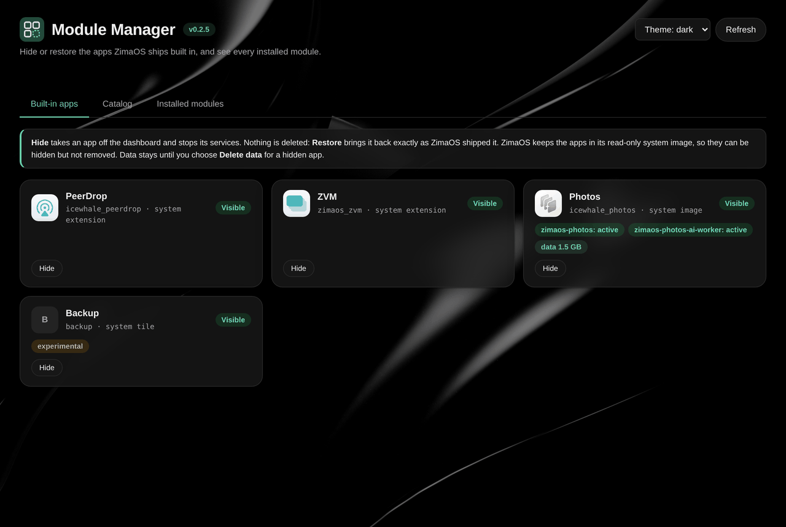
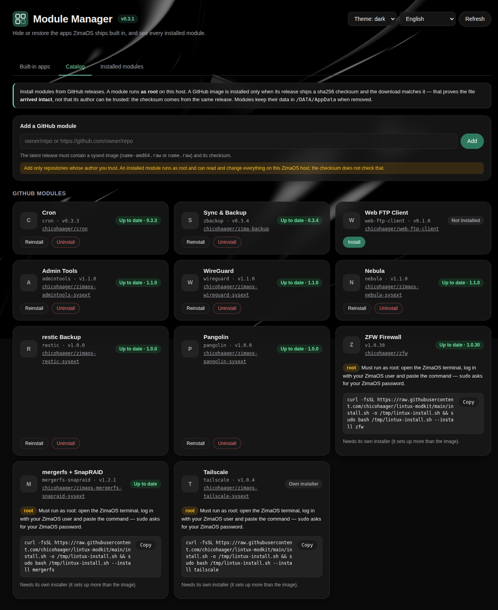
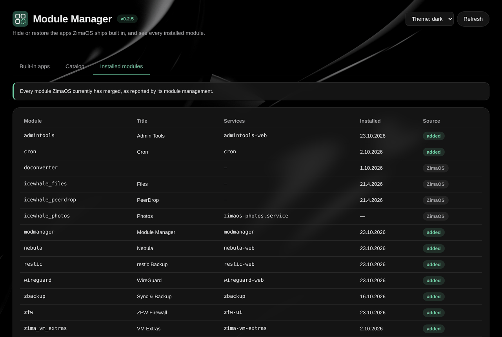

# Module Manager for ZimaOS

**Version 0.2.5** · ZimaOS 1.8.0 (amd64) · sysext module `modmanager`

Hide or restore the apps ZimaOS ships built in — Photos, PeerDrop, ZVM and the Backup tile — and see every installed module. Nothing is deleted unless you ask for it: **Restore** brings an app back exactly as ZimaOS shipped it.



| Catalog | Installed modules |
|---|---|
|  |  |

Screenshots: Module Manager 0.2.5 on a ZimaBoard 2 with ZimaOS 1.8.0 (dark theme), 2026-10-23. Changes per release: [CHANGELOG.md](CHANGELOG.md).

## How each kind of app is hidden

ZimaOS 1.8 has three kinds of built-in tile, and each needs its own way out (measured on ZimaOS 1.8.0):

| App | Kind | How it is hidden | Survives reboot |
|---|---|---|---|
| PeerDrop, ZVM | system extension in `/usr/lib/zimaos/modules` | empty directory `/etc/extensions/<name>` masks the image (systemd-sysext(8)), then `systemd-sysext refresh` | yes (measured) |
| Photos | part of the read-only system image | a directory extension shadows its manifest with `ui.show: false`; `zimaos-photos` and `zimaos-photos-ai-worker` are disabled and masked | yes (measured) |
| Backup | hard-coded in `zimaos-user` | a `deny` tuple for `visible` in zimaos-user's database — **experimental**, see below | yes (measured) |

Why not the built-in uninstall: ZimaOS' own module uninstall only removes the symlink in `/var/lib/extensions`, and `/usr/libexec/every-boot.d/01-re-symlink-modules` puts it back on every boot.

**Delete data** (hidden apps only) removes the app's data directory — today only Photos has one, `/DATA/AppData/photos` (index, settings, models). It is refused if a photo or video file is found inside, and you must type the app's name.

`doconverter` cannot be hidden: Files and search depend on it.

### The Backup tile is experimental

The Backup tile can only be hidden by writing into `/var/lib/casaos/db/user.db`, an internal store of ZimaOS. Its permission API declares deny as supported, but the write endpoint (`PUT /v2/permissions/grants`) has no field for it in 1.8.0. So Module Manager:

- offers it only on ZimaOS versions it was verified on (`v1.8.0`), restore stays possible on any version,
- checks the table layout before every write and refuses when it changed,
- takes an online backup of `user.db` before every write (`/DATA/AppData/modmanager/userdb-backups/`, mode 0600, newest 5 kept).

## Catalog

Version 0.2.0 adds a catalog: the Lintux module repositories (cron, Sync & Backup, Web FTP Client and — since 0.2.5 — Admin Tools, WireGuard, Nebula and restic Backup installable here; ZFW, mergerfs + SnapRAID and Tailscale with their own installer, whose command is shown — it must run as root on the host — paste it into the ZimaOS terminal; the UI says so above the command), and any GitHub repository you enter. The Mod Store list of ZimaOS' module management is not shown. Installation goes through `zpkg`, IceWhale's module CLI. Files is not listed among the built-in apps: ZimaOS needs it.

A GitHub image is installed only when its release ships a sha256 checksum and the download matches it, and only when none of its files exists on the host already: a module overlays `/usr`, so such a file would replace ZimaOS' own for every service (the check lists the image with the host's `unsquashfs`; on an update the files of the installed version do not count). **That proves the file arrived intact — not that the module's author can be trusted:** the checksum comes from the same release as the image. A module runs as root on the host. Add only repositories you trust; the UI marks them as third-party.

For the Lintux modules the catalog shows the **installed version**, read where the module reports it (the health route of Cron, Sync & Backup, ZFW, Admin Tools, WireGuard, Nebula and restic Backup, `SYSEXT_VERSION_ID` for Tailscale) and compared semver-style with the latest release — a development build counts as older than its release, as in the lintux installer. Without a health route the catalog reads `SYSEXT_VERSION_ID` from the module's extension-release — for any module, also repositories you add. The build scripts of Cron, Sync & Backup, Web FTP Client and mergerfs + SnapRAID write it from their next build on; images built before have none, and then the installed image is compared byte for byte with the release image ("Differs from vX").

## UI

Light theme in the ZFW Firewall style, dark theme following the ZimaOS dark desktop (same wallpaper, translucent cards). Theme: auto (follows the system), light or dark.

Language: English or German. **auto** follows the ZimaOS user's language (`/v1/users/current/custom/system`, e.g. `de_DE`), the menu next to the theme overrides it (kept in the browser). The German texts address the user as „Sie“, like ZimaOS' own German UI. Error messages with a code are translated; for an unexpected error the German frame shows the server's (English) detail. `scripts/i18n-check.mjs` (run by `build.sh` and CI) fails when a text, a key of `index.html` or an error code of the Go backend has no English and German text.

## Build

```sh
sh build.sh amd64      # vet, tests, node --check, go build, sysext via ../lintux-modkit/sysext/build-sysext.sh
```

Output in `dist/`: `modmanager-amd64.raw` (+ `.sha256`) and `modmanager.raw`.

## Install (on the ZimaOS host)

In the ZimaOS terminal (amd64):

```sh
cd /tmp
curl -fsSLO https://github.com/chicohaager/modmanager/releases/latest/download/modmanager-amd64.raw
curl -fsSLO https://github.com/chicohaager/modmanager/releases/latest/download/modmanager-amd64.raw.sha256
sha256sum -c modmanager-amd64.raw.sha256       # must print: modmanager-amd64.raw: OK
mv modmanager-amd64.raw modmanager.raw         # zpkg takes the module name from the file name
sudo zpkg install /tmp/modmanager.raw          # update: sudo zpkg remove modmanager first
```

The rename is required: `zpkg install /tmp/modmanager-amd64.raw` fails with `module not pass validate` (measured on ZimaOS 1.8.0, 22.10.2026); under the name `modmanager.raw` the same image installs.

**Update** (in the release after 0.2.5): when a newer release exists, Module Manager shows **Update to v…** next to its version. A second click downloads the release, checks its checksum and that it replaces no file of ZimaOS, keeps a copy of the installed image and hands the swap to a transient unit (`systemd-run`): `zpkg remove modmanager`, `zpkg install` of the new image — and if that fails, the previous image is installed again. The page reloads once the new version answers. Files and log: `/DATA/AppData/modmanager/self-update/`. Measured on ZimaOS 1.8.0 (ZimaBoard 2), 2026-10-23: a build claiming 0.2.4 updated itself to the v0.2.5 release in 8 s; the installed image was byte-identical with the release, no failed unit. Up to 0.2.5 update by hand: `sudo zpkg remove modmanager` first, then the steps above.

The service installs its own boot watchdog units in `/etc/systemd/system` (lintux-modkit `watchdog`).

## Notes for developers

- The service must run in the host's mount namespace: `systemd-sysext refresh` from a private namespace changes only the service's view. `cmd/modmanager/unit_test.go` keeps namespace directives (`Protect*`, `Private*`, …) out of the unit; the manager also checks `/proc/self/ns/mnt` against PID 1 before every action.
- `go test -race ./...` — the permission tests use the real `sqlite3` binary against the schema measured on 1.8.0.
- Releases: see [RELEASING.md](RELEASING.md). After publishing a release, check it against a host that runs it: `python3 scripts/catalog-e2e.py --url http://<zimaos-host> --user <name> --password-file <file>`. It adds this repository to the catalog, asserts that the release image is picked and the installed version is current, then removes the repository again. `--selftest` runs without a host.

MIT License, see [LICENSE](LICENSE).
